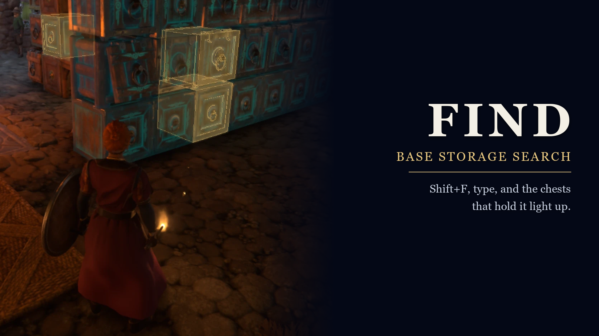
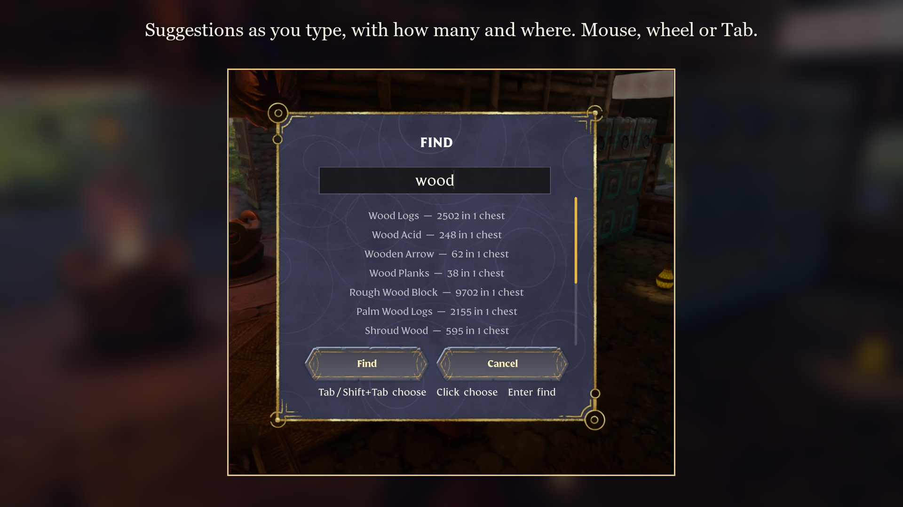

# Find – Base Storage Search

An Enshrouded mod: press **Shift+F** in your base, type an item, a kind of item or a chest
name, and the chests that hold it light up. Open one and the items you searched for glow gold.

## Install

1. Close Enshrouded.
2. Download the release zip and copy `wsock32.dll` into the game folder, next to
   `enshrouded.exe` (Steam: right-click Enshrouded > Manage > Browse local files).
3. Start the game, stand inside one of your bases and press Shift+F.

Uninstall: delete `wsock32.dll`, plus `find.ini` and `find.log` if present. Client-side only:
servers and other players need nothing. Find only reads your chests; it never moves an item.

## Use

1. Stand inside one of your bases and press **Shift+F** (changeable in `find.ini`). Find
   only opens while you are playing or in your backpack, never while you type in chat,
   rename something or write on a signpost. Outside a base it only says so: the field
   stays empty and Enter or Esc closes it.
2. Type an item, a chest name, or a kind of item. Suggestions appear as you type.
   - **Tab / Shift+Tab** (or Down / Up) go through the suggestions, or click one with the
     mouse (click it again to find it right away). **Enter** finds, **Esc** cancels. A bar
     beside the list shows where you are when there are more suggestions than fit.
   - A suggestion picked with Tab finds just that item, chest or kind.
   - Typed text finds every name with a word starting with it: `stone` finds Stone and
     Rough Stone Block, `arrow` finds every arrow but not Narrow Wall.
3. The matching chests pulse. Open one and the found items in it pulse gold for about five
   seconds, the first time you open it. A chest's pulse ends a few seconds after you reach it
   or open it; every pulse ends after three minutes, with your next search, or when you leave
   the base.

## Settings

`find.ini` (written with the defaults on the first start; settings an older `find.ini` lacks
are added to it) holds:

| Setting | Default | What it does |
| --- | --- | --- |
| `hotkey` | `Shift+F` | the key that opens the search: a letter, digit or F1-F12, with `Shift+`, `Ctrl+` and/or `Alt+` in front if you like |
| `glow_seconds` | `180` | the found chests glow at most this long (10-3600), or until your next search |
| `near_meters` | `2.5` | coming this close to a found chest counts as reaching it (0.5-20) |
| `near_seconds` | `3` | a chest stops glowing this long after you reach or open it (0-60) |

Restart the game after changing them.

## What you can search for

- **Items**, by the name the game shows.
- **Kinds of items**: categories (Consumables, Ammunition, Materials, ...), rarities
  (Uncommon to Legendary), item types (One-Handed Axe, ...) and perks (Backstab Damage,
  Multishot, ...).
- **Chest names you gave yourself** with Rename. The game's own chest titles,
  "Storage Chest" and its variants (Large Storage Chest and the like), are not searched:
  every unnamed chest would match.

Suggestions say what they are: `Granite Block — 996 in 1 chest`, `Perk: Backstab Damage — 12
items in 3 chests`, `Chest: Arrows`. Find follows the game's language: item, perk, category
and rarity names are the game's own, and Find's few texts of its own come in English, German,
French, Spanish, Italian, Portuguese, Polish, Russian, Ukrainian, Japanese, Korean, Chinese and
Turkish.

## Building

Needs Windows, the Visual Studio 2022 Build Tools (C++ x64) and nothing else.

- `build.bat` builds the release: `bin\wsock32.dll`, a proxy DLL that forwards every Winsock
  call to the Windows `wsock32.dll` and loads Find inside the game.
- `tools\tests.bat` and the other `tools\*-tests.bat` run the offline tests (hook
  trampolines, hotkey parsing, the proxy, the hot loader, the renderer helpers).
- `tools\make_images.py` builds the Nexus page images from screenshots (needs Pillow).

### Development build

`build-dev.bat` builds `bin-dev\loader\find.dll` with diagnostic logging (`FIND_DEV`). Under
the Greeneye Loader with `greeneye\hotreload.enable`, `..\tools\hot-reload.ps1 find -Dev`
swaps it into the running game without a restart (see [HOTLOADING.md](HOTLOADING.md)). New hook
sites still need a restart. Use the release build for playing and for releases.

## How it works

Find is a proxy DLL loaded by the game. It finds the game functions it needs by byte
signatures (so it switches itself off rather than crash after a game update), and hooks the
in-game UI to draw its search box with the game's own text-input dialog, its chest highlight
through the game's renderer, and the gold boxes in an opened chest through the game's
inventory slot drawing. Base, chest and item data are read from the client's own state; names
come from the game's localisation, so the mod follows the game's language.

## License

MIT, see [LICENSE](LICENSE). Not affiliated with Keen Games. Made with the help of AI (Claude
by Anthropic, with parts by OpenAI Codex).
